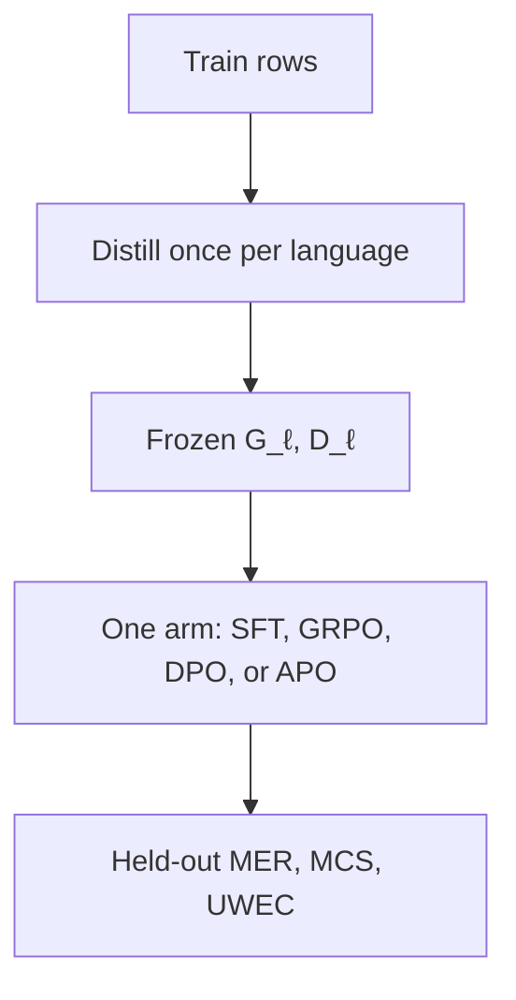
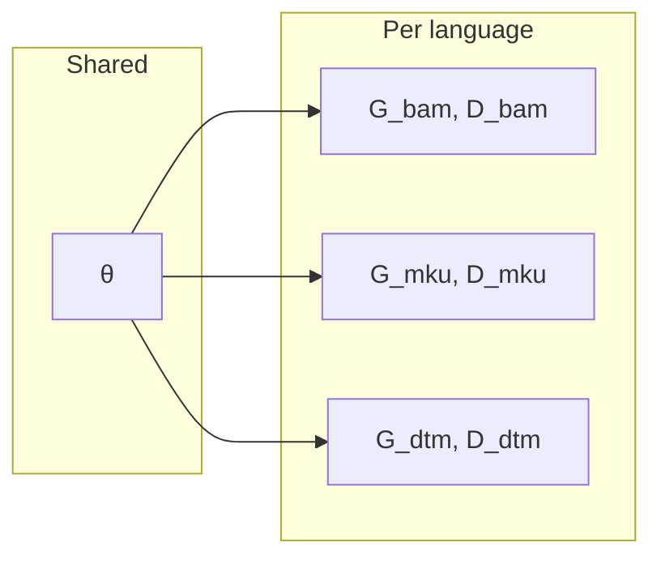
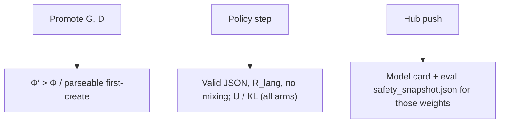

# Architecture

Sebeni is a recursive loop between a rule-based morphological analyzer (Daba)
and a small language model (SLM). Nothing in this page is FastText,
Matryoshka embeddings, or a chatbot — those tracks are out of scope.

Public URL: [mlsftwrs.github.io/sebeni](https://mlsftwrs.github.io/sebeni).

## Three product phases

1. **Distill resources** — once per language, on the train split. If Φ is below τ, Distiller proposes a candidate grammar G and dictionary D and promotes them only when Φ′ improves. The result is frozen.
2. **Train one arm** — SFT, GRPO, DPO, or APO reads that frozen checkpoint and starts from the base model. Arms do not promote new G or D.
3. **Evaluate** — the trained weights are decoded greedily on held-out rows (packaged `test.json`, or `experiment.eval_source`) and scored for MER, MCS, and UWEC for model \(m\), algorithm \(\mathcal{A}\), and scope \(l\). MER and UWEC are costs to minimize; MCS is a stage-match fraction to maximize. MULTI13 pools morphemes (MER) and tokens (MCS, UWEC) across languages; top-level Φ is a macro mean over languages.



## One θ, many (G, D)



## SafetyGovernor gates



The policy gates (format, R_lang, mixed language, uncertainty
down-weighting, optional `max_kl`) apply to SFT, GRPO, DPO, and APO. GRPO
judges its own samples; SFT / DPO / APO judge their training targets. A refused
update skips `optimizer.step` entirely. Promote also checks `max_mer` and the
dictionary's `\lang` header. Hub push refuses unless `README.md` and a
`safety_snapshot.json` from `sebeni eval` for exactly those weight files sit
next to them; push writes nothing itself. Details: [Safety](safety.md).

## Objects

| Symbol | Role |
| --- | --- |
| \(T\) | Alignment dataset: `{text, lang}` rows |
| \(B_ℓ\) | Texts in the batch whose group code is ℓ |
| \(G_ℓ, D_ℓ\) | Daba `.gram` / `.dict` for that group |
| \(\Phi_ℓ\) | Mean token stage score of \(B_ℓ\) given \(G_ℓ, D_ℓ\) |
| \(\tau\) | Default **0.5** |
| \(\theta\) | **One** shared policy, even when \(T\) is multilingual |
| Distiller | Proposes G, D (not `distillation_hook`, which is KL scaling) |

## Package layout

```
beni/
  cli/main.py              sebeni init|distill|train|eval|exp|wordfreq|generate|push
  core/pipeline.py         distill once, one arm, held-out eval
  core/srl/                SFT, GRPO, DPO, APO arms
  core/safety/             SafetyGovernor gates
  core/compute/            Φ, MER, MCS, UWEC (NumPy/JAX kernels), RewardManager
  core/morphotactic/       Distiller, DabaX (CLI daba.mparser)
  core/language.py         ISO → group_code (mku, mey, kao, spp)
  core/hub/                model cards
  core/wordfreq/           surface / lemma / morpheme / stage counts
  data/baselines/{lang}/   packaged G, D (Maninka under mku/)
  data/presets/            multi13.yaml, single.yaml (sebeni exp --preset)
  data/raw/dataset_300_samples.jsonl   experiment train split
  data/test.json           packaged eval texts for sebeni exp
  utils/                   workdir, prompts, language metadata
```

Relocatable workdir (later wins): `~/.sebeni` → `SEBENI_HOME` /
`SEBENI_WORKING_DIR` → YAML `working_dir` → CLI `-w`.

| Path under workdir | Contents |
| --- | --- |
| `data/baselines/{lang}/` | `baseline.gram` / `.dict`, then `baseline_vN`. Arms and eval read G, D from here. |
| `data/resources/{lang}/` | Snapshot after distill: `baseline.*`, `distilled.*`, `hashes.json` |
| `data/resources/frozen.json` | Freeze marker + per-language promote decisions; `sebeni train` skips distill when present |
| `data/sft/train.jsonl` | SFT labels (SFT arm only) |
| `models/` | Policy, tokenizer, `sebeni_policy.json` (training prompt languages), Hub `README.md`, `safety_snapshot.json` (`sebeni eval` rewrites it with eval metrics, keeping the training record under `training`) |
| `exp/eval.json` | Held-out metrics ([fields](rewards.md#evaljson)) |
| `exp/manifest.json` | Model, scope, method, seed, commit, dataset fingerprint, per-stage records |
| `exp/sft_label_report.json` | SFT accepted / invalid label counts |
| `exp/report.pdf`, `exp/report_train.pdf`, `exp/report_eval.pdf` | K-Veritas sealed reports from `exp`, `train`, `eval` (when `experiment.kveritas_seal` is on) |
| `exp/sebeni_code.json` | sha256 of every `beni` source file + version (K-Veritas input) |
| `exp/wordfreq/` | `wordfreq.json` + per-language counts |
| `runtime/` | Headless mparser scratch |

`sebeni exp` always re-distills before training. Default `output_dir` and
`runtime_dir` follow the resolved working dir.

## What Sebeni does *not* do

- Vendor GPL `daba` sources (install maslinych/daba from GitHub with
  `--no-deps` for its CLI modules).
- Require wxPython (`[gui]` is optional for upstream gparser).
- Treat G or D as dataset columns.
- Mix languages **inside** one completion JSON object (`R_lang` is 0).
