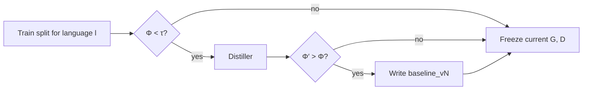

# Distillation and DabaX

Distiller proposes candidate grammar and dictionary files when Φ on a
language's **train split** falls below τ. Sebeni promotes a packaged baseline
only if Φ′ > Φ (and SafetyGovernor agrees). A scratch language promotes its
first checkpoint once when it parses; after that a real Φ′ > Φ is needed. The
checkpoint is then frozen. Policy arms do not promote again.



`sebeni distill` is this stage. `sebeni train` runs it only when resources are
not already frozen, then trains one arm. `distillation_hook` is KL scaling,
not Distiller.

## What Distiller writes

Daba-compatible **G** (`.gram` finite-state / Select-Mark rules) and **D**
(`.dict` SIL Toolbox / MDF fields).

- The **algorithmic** backend never edits **G**. For each stage −1 surface not
  already in **D** it appends a stub entry:

  ```
  \lx <surface>
  \ps x
  \ge auto:<surface>
  ```

  These stubs count as unanalysed (stage −1) in Φ and Φ′, so they cannot
  inflate Φ′, and stubbed words stay in the miss list for an LLM backend.
  Beyond a scratch language's first checkpoint, the algorithmic backend alone
  rarely promotes; use an LLM backend for real gains.
- **LLM** backends return G and D deltas (`[ADD]`, `[REPLACE:]`, `[DELETE:]`,
  `[REMOVE:]`). Each delta is kept only if the result still parses. With no D
  delta, the algorithmic stubs are tried instead.

Exactly one proposal is made per language.

Promoted files are versioned `baseline_vN` under
`{working_dir}/data/baselines/{lang}/`.

## CLI

```bash
sebeni distill -c config.yaml
sebeni distill -c config.yaml --lang multi13 --hitl
sebeni distill -c config.yaml --lang bam,mku --hitl
```

The default `algorithmic` backend needs no API key. Use `distill` when you want
G, D without a policy step.

## Backends and authentication

```yaml
distillation:
  enabled: true
  backend: algorithmic      # algorithmic | gguf | google | openai | groq | together
  model: gemini-2.5-flash   # LLM backends only (see defaults below)
  tau: 0.5
  hitl: false
  # vertex: true            # ADC / Vertex AI; omit to auto-select when ADC is present
  location: global          # Vertex region; global disables context caching
  project_id: null          # else GOOGLE_CLOUD_PROJECT / ADC quota project
  base_url: null            # OpenAI-compatible endpoints (Ollama, vLLM)
  gguf_path: null
  n_ctx: 4096
  max_input_chars: 8000
```

`provider:` is a deprecated alias of `backend:`. `gemini` is an alias of
`google`.

**Default model.** The pipeline always passes `distillation.model` to
Distiller. `DistillationConfig`, `Distiller`, `GoogleProvider`, and
`sebeni init` share one default, `gemini-2.5-flash`
(`cfg.DEFAULT_DISTIL_MODEL`). The matrix scripts set `gemini-3.7-flash`
explicitly.

- `algorithmic` builds a DabaX stage −1 miss list and adds conservative `\lx`
  entries. This is the train/exp default.
- `google` uses Vertex/ADC when `vertex: true` or ADC is present
  (`GOOGLE_CLOUD_PROJECT` / application-default credentials). A leftover
  `GOOGLE_API_KEY` does not override ADC. Set `vertex: false` for AI Studio.
- Vertex with `location: global` (the default) skips context caching and
  sends the instructions as `system_instruction`. A regional location (e.g.
  `us-central1`) enables caching.
- `.env` is loaded from the current directory, the config directory,
  `SEBENI_ENV`, and the workdir; existing process variables win.
- OpenAI-compatible backends accept `base_url` for Ollama/vLLM.
- `gguf` requires `sebeni[gguf]`. Its limited context and lack of hosted
  caching/optimization can reduce quality and throughput.

LLM prompts carry the DabaX miss report. When a Google context cache is
created, its contents include the full grammar and up to 50,000 characters of
the dictionary — the whole file for small languages. With a cache, the
per-call delta / bootstrap instructions travel in the request contents (Gemini
rejects `system_instruction` together with `cached_content`), so they are sent
on every request.

## Scratch bootstrap

No packaged `beni/data/baselines/{lang}/` → Distiller writes lookup-only stubs
under the workdir. Algorithmic bootstrap adds missing surfaces as lemmas.

| Promote | Gate |
| --- | --- |
| First create (scratch, once) | files must be **parseable** by DabaX |
| Later `baseline_vN` | Φ′ > Φ on **that language's** train texts (stubs count as unanalysed), and candidate MER vs the current parse ≤ `safety.max_mer` |
| Every promote | the candidate dictionary's `\lang` header names this language (a candidate without one passes only when the current D has none) |

A Distiller exception is recorded as `reason: distill_error` and the previous
G, D are kept. Other reasons are listed on [Safety](safety.md).

`--hitl` prints a grammar/dictionary head and asks `[y/N]`. Skipped when stdin
is not a TTY (CI).

## DabaX

Wraps CLI `daba.mparser` (`DictLoader`, `GrammarLoader`, `Tokenizer`,
`Processor`). No wxPython / `gparser` / `gdisamb` on the default install.
Upstream credit: [maslinych/daba](https://github.com/maslinych/daba) (GPLv2+).
Install it with
`pip install "daba @ git+https://github.com/maslinych/daba.git" --no-deps`.
Sebeni pins `setuptools` (`pkg_resources`) and the other CLI runtime libraries.
Do not vendor GPL sources into this MIT tree.

```python
from beni.core.morphotactic.distil.distillation import Distiller
from beni.core.morphotactic.dabax import DabaX

d = Distiller(lang_code="bam", backend="algorithmic", working_dir="./runs/bam")
d.handle_baselines()
phi = d.phi_on_texts(["Aw ka kɛnɛ wa?"])

dx = DabaX("bam", gram=d.gram_path, ldict=d.dict_path, process=True)
sentences = dx.loader("Aw ka kɛnɛ wa?")
```

Φ here is morphological integrity of the **strings**, given G and D — the
same quantity SAMPG compares to τ.
