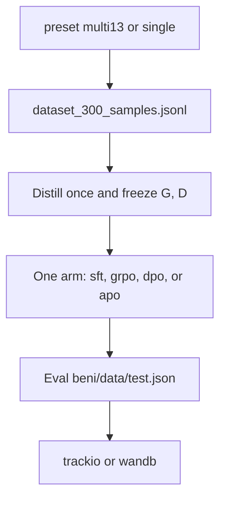

# Experiments

`sebeni exp` is the batteries-included path: distill frozen grammar and
dictionary from the packaged experiment jsonl (or your `data.source`), train
**one** arm, then evaluate packaged `beni/data/test.json` (or your
`experiment.eval_source`). Pick a preset and an algorithm.

```bash
sebeni exp --preset multi13 --algorithm sft -w ./runs/multi13-sft
sebeni exp --preset single --lang bam --algorithm grpo -w ./runs/bam-grpo
sebeni exp --preset single --lang bbo --algorithm sft -w ./runs/bbo-sft
# alias: sebeni experiment
```

If `-c` and `--preset` are omitted, Sebeni loads the MULTI13 preset
(`beni/data/presets/multi13.yaml`). Presets ship in the package
(`beni/data/presets/`: `multi13.yaml`, `single.yaml`); an unknown `--preset`
exits with code 2 and lists the available presets. `exp` always re-distills, even
when `data/resources/frozen.json` exists.

`exp` trains on `data.source` when the `-c` config sets it; otherwise, and
always with `--preset`, the train file is
`beni/data/raw/dataset_300_samples.jsonl`. It prints the choice as
`[exp] train data: <source> (<n> rows; lang=n, …)`. Codes in the packaged file are remapped
before distillation: `mlq` → `kao`, `hsy` → `mey`, `seq` → `spp`. `bbo` is
kept only for `--lang bbo`.



## What gets loaded

| Split | Source | Language |
| --- | --- | --- |
| Train | `data.source` from `-c`, else `beni/data/raw/dataset_300_samples.jsonl` | experiment remap (packaged file), then group code |
| Eval | `experiment.eval_source`, else `beni/data/test.json` | object `{lang: text}`; paragraphs split; evaluation only |

`bbo` rows stay in the jsonl and are excluded from MULTI13. A language with no packaged baseline uses Distiller scratch bootstrap. `raw/*.txt` remains available to `sebeni wordfreq` and to `sebeni train` when `experiment.dataset` is `raw`.

Custom `data.source` applies to `sebeni exp` (with `-c`), `train`, and
`distill`. Held-out rows come from `experiment.eval_source` (a path, glob,
list, or Hugging Face dataset id, like `data.source`; relative paths and globs
resolve against the config file's directory) or `sebeni eval --eval-file`;
otherwise from packaged `test.json`. A `{lang: text}` `.json` shaped like
`test.json` is split into paragraphs. Wordfreq uses `wordfreq.raw_inputs`
(with `data.source` as a compatibility fallback).

`experiment.max_eval_rows` caps the paragraphs decoded and scored per
language. The default `null` (or `0`) scores every held-out row; a negative
value is an error. It does not size the in-training eval split: that is
`data.eval_ratio` (default 0.1) or `data.eval_rows` (a row count; `0` disables
the split), also `train --eval-ratio` / `--eval-rows`. Rows whose reference
has no morphemes are skipped and counted in `n_skipped` in `eval.json`.

## YAML knobs

Without `-c`, `exp` reads
[`beni/data/presets/multi13.yaml`](https://github.com/mlsftwrs/sebeni/blob/main/beni/data/presets/multi13.yaml)
(or `single.yaml` with `--preset single`). Copy one, edit it, and pass `-c`.
[`configs/exp.yaml`](https://github.com/mlsftwrs/sebeni/blob/main/configs/exp.yaml)
is a separate MULTI13 config with reward weights 0.1/0.4/0.4/0.1 (the preset
uses 0.2/0.3/0.3/0.2). Knobs:

- `model.model_name` (and LoRA / 4-bit)
- `algorithm: sft | grpo | dpo | apo`
- `trainer.*` (`lr`, `max_steps`, `batch_size`, `num_generations`, …)
- `trainer.report_to: trackio | wandb | none` (default `trackio`)
- Distiller `backend` / `model` / `tau` / `enabled`
- `experiment.max_eval_rows` (rows scored per language), `eval_source`, `eval_max_new_tokens`

```yaml
experiment:
  max_eval_rows: null      # null = every held-out row per language
  # eval_source: ./my_test.jsonl   # default: packaged test.json
  kveritas: false          # re-launch under `kveritas run`, print KV lines
  kveritas_seal: false     # seal {working_dir}/exp/report.pdf
  kveritas_disclosure: open        # redacted | names | open
  kveritas_local: false            # sign with a local key, no attestation server
  # kveritas_local_key: null       # default {working_dir}/keys/private.pem
```

`report_to: wandb` needs `pip install "sebeni[train,wandb] @ git+https://github.com/mlsftwrs/sebeni.git"`.
Trackio stays in `[train]`.

## Artifacts

| Path | What |
| --- | --- |
| `{working_dir}/exp/eval.json` | MER, MCS, UWEC, Φ per language and pooled for the scope |
| `{working_dir}/exp/manifest.json` | model, algorithm, scope, seed, resource hashes |
| `{working_dir}/exp/report.pdf` | K-Veritas seal of `sebeni exp` (`experiment.kveritas_seal: true`); `train` / `eval` write `report_train.pdf` / `report_eval.pdf` |
| `{working_dir}/exp/sebeni_code.json` | K-Veritas code manifest (sha256 of every `beni` source file, version) |
| `{working_dir}/data/baselines/{lang}/` | G, D checkpoints; the arm and eval parse with the latest |
| `{working_dir}/data/resources/{lang}/` | Frozen snapshot (`baseline.*`, `distilled.*`, `hashes.json`) |
| `{working_dir}/data/resources/frozen.json` | Freeze marker with per-language distill decisions |
| `{working_dir}/models/` | Policy, tokenizer, model card, `sebeni_policy.json`, `safety_snapshot.json` (rewritten by eval for these weights) |
| tracker | Trackio or Weights & Biases, per `report_to` |

Every arm reports the same held-out metrics. MER and UWEC are costs (lower is
better). MCS is the fraction of tokens whose predicted stage matches the
reference stage, paired by index (higher is better); training uses the same
match fraction. Scope scores pool reference morphemes (MER) and tokens (MCS,
UWEC), so a language with more units weighs more in MULTI13. Φ is a macro mean
over languages. UWEC is evaluation-only.

## K-Veritas (optional)

Not a hard dependency. On Linux, `pip install` tries to download the
`kveritas` binary (from `27-GROUP/kveritas-releases`) into the environment
`bin/`, then `/usr/local/bin`, then `~/.local/bin`, when it is not already on
`PATH`. Other platforms install it manually.

With `experiment.kveritas: true` (or `--kveritas` on `sebeni exp`, `train`, or
`eval`), the command re-launches itself **once** as the monitored process of
`kveritas run`, so the record covers everything it does. Do **not** wrap
`sebeni` in `kveritas run` yourself. `--kveritas-seal/--no-kveritas-seal`
overrides `experiment.kveritas_seal`; `--no-kveritas` also turns sealing off.

1. Sebeni runs `kveritas init --disclosure <experiment.kveritas_disclosure>`
   (`redacted`, `names`, or `open`; default `open`) in the working directory
   if no `.kveritas/` session exists. With `experiment.kveritas_local: true`
   it adds `--local` and signs with a local key instead of the attestation
   server: `experiment.kveritas_local_key` (PEM path, default
   `{working_dir}/keys/private.pem`; create it with
   `openssl genrsa -out <path> 3072`). A previously sealed session is moved
   aside first.
2. The inputs are hashed (`kveritas run --files`): the config, the train data,
   `test.json` (and `eval_source`), and `{working_dir}/exp/sebeni_code.json`
   (sha256 of every `beni` source file plus the version), so the report covers
   the code that ran.
3. The monitored run prints lines
   [K-Veritas](https://kveritas.org/docs) records: per-step metrics from every
   arm (SFT, GRPO, DPO, APO), phase boundaries, the seed, and the eval claims
   (`phi`, `mer`, `mcs`, `uwec`, for the scope and per language as `_<lang>`):

```text
KV phase train
KV loss=0.82 step=10
KV seed 42
KV claim phi=0.51 phase=eval
KV claim phi_bam=0.60 phase=eval
```

With sealing on, each command seals its own one-run session:

| Command | Report |
| --- | --- |
| `sebeni exp` | `{working_dir}/exp/report.pdf` (one run covering distill → train → eval) |
| `sebeni train` | `{working_dir}/exp/report_train.pdf` |
| `sebeni eval` | `{working_dir}/exp/report_eval.pdf` |

K-Veritas refuses to seal a session in which a later run rewrote JSON files an
earlier run made. If the session cannot start (for example, the attestation
server is down), Sebeni stops and suggests `experiment.kveritas_local: true` or
`--no-kveritas`. If `kveritas` is not on `PATH`, it warns and runs
unmonitored. Ctrl-C / SIGTERM are forwarded to the monitored run. Verify with
(keep the `.kvbundle.zip` next to the PDF):

```bash
kveritas verify ./runs/exp-001/exp/report.pdf
```

## Distiller keys

Same as `sebeni train`: the default algorithmic Distiller needs no key.
Optional Google refinement accepts ADC or `GOOGLE_API_KEY`.

## Next

- [Cookbooks](getting-started.md#cookbooks) for Colab / Kaggle notebooks
- [Use cases](use-cases.md) for your own jsonl
- [SAMPG](sampg.md) for distill → one arm → eval
- [Rewards](rewards.md) for MER, MCS, and UWEC
- [Hyperparameters](hyperparams.md) for every YAML key
