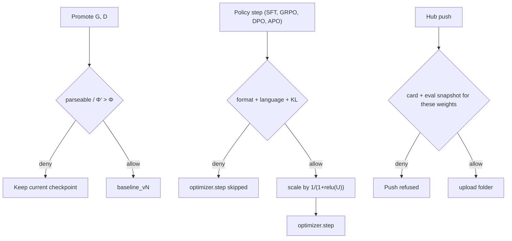

# Safety

`SafetyGovernor` is meant to be consulted on every SAMPG promote, policy
update (SFT, GRPO, DPO, and APO), and Hub export. It encodes ELRL linguistic
integrity **and** reward distrust (noisy `π_rf` must not update θ unchecked).



All reported runs trained against frozen G, D, and no gate fired. Treat the
gates as a mechanism, not a validated safeguard.

## SafetySpec (default-on)

| Gate | Default | Status |
| --- | --- | --- |
| Morphological integrity | on | **Enforced** on promote: scratch first-create needs parseable files; every later checkpoint needs Φ′ > Φ |
| Checkpoint integrity | on | **Enforced**: Distiller writes `baseline_vN` only when the promote gate allows it |
| Format | on | **Enforced (all arms)**: refuses the step on format-invalid output (`format_invalid_batch`; see samples vs targets below) |
| Language identity | on | **Enforced (all arms)**: `require_language` refuses wrong-language output (`language_mismatch_batch`), `refuse_mixed_language` refuses mixed-language output (`mixed_language_batch`). A completion declaring several languages is mixed and also scores 0 on `R_lang`. On promote, the candidate dictionary's `\lang` header must name the language (`language_mismatch`). |
| Reward distrust | on | **Enforced (all arms)**: gradients scaled by \(1/(1+\operatorname{relu}(U))\) |
| KL cap | off | `max_kl` refuses the step when the logged KL exceeds it (`kl_bound`) |
| `max_mer` on promote | 1.0 | **Enforced**: a later checkpoint is refused when the candidate parse's MER against the current parse exceeds it (`mer_exceeded`) |
| Release integrity | on | **Enforced**: push needs `README.md` and an eval `safety_snapshot.json` for exactly the pushed weights; nothing is auto-written |

Promote decision reasons (in `frozen.json` and the manifest): `phi_above_tau`
(Distiller skipped), `no_proposal`, `hitl_rejected`, `first_create`,
`unparseable_bootstrap`, `unparseable_candidate`, `phi_not_improved`,
`phi_improved`, `language_mismatch`, `mer_exceeded`, `distill_error`
(previous G, D kept), `empty_batch`.

## Policy steps

The governor judges different signals per arm (`signal_source`, shown in the
end-of-training summary line):

| Arm | `signal_source` | A step is refused when |
| --- | --- | --- |
| GRPO | `samples` (its own completions) | **no** completion is good: all format-invalid, none in the right language, or all mixed-language. Bad completions are already pushed down by their reward. |
| SFT, DPO, APO | `targets` (SFT labels, DPO/APO chosen answers) | **any** target is invalid, in the wrong language, or mixed-language |

Targets are also checked once before training, and refused rows are dropped
(gates `format_invalid_target`, `language_mismatch_target`,
`mixed_language_target`). SFT / DPO / APO rows whose prompt + answer is longer
than the arm's `max_length` are dropped too (`overlength_target`), not
truncated. Counts are in `exp/sft_label_report.json` and the safety snapshot.
DabaX targets run to hundreds or thousands of tokens, so set `max_length`
accordingly.

Log-ratio signals for U and `max_kl`: SFT per target token (π_θ vs the
adapter-off / reference model); DPO / APO from TRL's `rewards/chosen` and
`rewards/rejected`, divided by answer length (per-token
\(|\log \pi_\theta / \pi_{ref}|\)).

A refused update **skips `optimizer.step` entirely**: θ is unchanged, with no
AdamW momentum or weight decay. `blocked_steps` is recorded, and a warning
prints after 10, 50, and every 100 consecutive refused steps. At the end of
training each arm prints:

```text
[SafetyGovernor] <arm>: signals=… blocked_steps=… gates_fired=… last_uncertainty=…
```

Maninka: metadata `group_code` is **mku**; packaged files are under
`baselines/mku/`.

## YAML

```yaml
safety:
  enabled: true
  require_language: true
  refuse_mixed_language: true
  require_phi_improve: true
  max_mer: 1.0                  # candidate MER vs current parse on promote
  format_invalid_blocks_update: true
  uncertainty_downweight: true
  require_model_card: true
  require_safety_snapshot: true
  require_eval_metrics: true    # push needs an eval snapshot (Φ plus MER or MCS)
  # max_kl: 0.5   # optional hard KL cap
```

τ is taken from `distillation.tau` (default 0.5). The governor's KL β is
`trainer.beta` for every arm (DPO/APO's own `beta` only shapes their loss).

## Distrust U vs UWEC

Training distrust U down-weights a noisy reward:

\[
U = \overline{\mathbb{I}(\mathrm{stage}\neq-1)} + \beta\,\overline{(\log\pi_\theta-\log\pi_{ref})}
\]

The log-ratio term is **signed** (a mean, not an absolute value). The update
scale is \(1/(1+\operatorname{relu}(U))\), so negative U never amplifies a
step. `u_indicator`, `u_kl`, and `uncertainty` are logged to Trackio and copied
into the training-time `safety_snapshot.json`; they never gate G/D promotion.

Held-out UWEC is a different quantity: it uses the **absolute** log-ratio and
is not a training gradient coefficient ([Rewards](rewards.md)).

## Snapshot

`sebeni eval` writes `{working_dir}/exp/eval.json` and a
`safety_snapshot.json` **next to the evaluated weights** (default the arm's
output dir, `{working_dir}/models`); a base-model eval writes it to `exp/`
instead, so it can never clear weights for a push. The eval snapshot keeps the
training record under `training` and stores `weights_sha256`, a hash of the
weight files it scored. The snapshot's `extra` fields (`scope`,
`by_language`, `uwec`, …) are flattened to top-level keys on disk.

`sebeni push` (also with `--write-card`) checks the folder it uploads: it needs
`README.md` (`missing_model_card`) and `safety_snapshot.json`
(`missing_safety_snapshot`) there; with `require_eval_metrics` the snapshot
must carry Φ and MER or MCS (`missing_eval_metrics`) and its `weights_sha256`
must match those weight files (`snapshot_weights_mismatch`). Nothing is
auto-written; `--write-card` re-renders `README.md` from the eval snapshot.
See [Hub model cards](hub.md).

## Python

```python
from beni.core.safety import SafetyGovernor, SafetySpec

gov = SafetyGovernor(SafetySpec(tau=0.5))
d = gov.allow_promote(phi=0.4, phi_prime=0.6, parseable=True, first_create=False)
assert d.allowed
```
