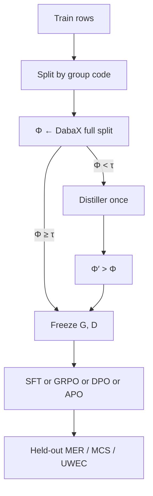

# SAMPG

**Self-Aware Morphotactic Pattern Generation** is the upstream resource step.
`sebeni distill` runs it once per language. `sebeni train` and `sebeni exp`
train one arm only after that checkpoint is frozen. Completions are
morphological analyses (JSON `tokens`), not a chatbot.

## Dataset vs G, D

```
T  = [(text, lang), …]           # jsonl / csv / HF rows / packaged raw
B  ⊂ T                           # a training batch
Φ  = DabaX(texts(B_ℓ), G_ℓ, D_ℓ) # integrity of those strings
```

**G** and **D** are Daba grammar/dictionary files. They are not dataset
fields. Mixed-language batches are split by group code; the policy θ is
still **one** model.

## Loop

1. Split the train rows by language. The experiment file remaps `mlq` → `kao`, `hsy` → `mey`, and `seq` → `spp` before this split.
2. For each language, Φ ← DabaX on that language's full train split.
3. If Φ < τ, Distiller proposes \(G_{cand}, D_{cand}\). A scratch language promotes its first checkpoint once when it parses; after that, promote when Φ′ > Φ and the candidate's MER against the current parse stays within `safety.max_mer`. The dictionary's `\lang` header must name this language. Algorithmic stubs (`\ps x`, `\ge auto:`) count as unanalysed in Φ / Φ′.
4. Snapshot baseline and distilled G, D under `{working_dir}/data/resources/{lang}/` (with `hashes.json`) and write `data/resources/frozen.json`.
5. One arm trains: SFT extracts labels, or GRPO / DPO / APO builds its training rows. DabaX references come from the latest checkpoint in `{working_dir}/data/baselines/{lang}/` (`baseline_vN`, else `baseline`, else packaged). The `data/resources/` copies are an audit record. No arm writes a new G or D.
6. Score completions against the frozen DabaX parse. U scales the policy update. U is not a reward and it is not Distiller.



`distillation_hook` is **KL scaling**, not Distiller. Policy steps do not call Distiller.

`sebeni train` skips distill when `frozen.json` exists; `sebeni exp` always
re-distills. All reported runs used frozen resources, so no promote gate fired
during policy optimization.

YAML `algorithm: sft | grpo | dpo | apo` selects the arm.
Register another with `register_algorithm(name, cls)`.

## Φ (morphological integrity)

Daba assigns a **stage** to each token:

| Stage | Meaning | Contribution to Φ |
| --- | --- | --- |
| Analyzed (`0 .. max`, non-EMPR) | Fully matched / analyzed | 1.0 |
| EMPR (grammar borrowing stage: 6 in `bam`, 4 in the other 12 baselines; or `gloss == "EMPR"`) | Validated loanword / borrowing | `empr` (default 0.5) |
| Above grammar EMPR stage | Other | `eps` (≈ 0) |
| −1 | Unrecognized | 0.0 |

Non-numeric stage labels count 1.0. Φ is the mean token score. If **Φ < τ**
(0.5), Distiller runs. The default `algorithmic` backend only appends `\lx`
stubs for stage −1 surfaces to **D**; only LLM backends propose **G** deltas.
Those stubs count as unanalysed in Φ / Φ′, so they cannot raise Φ′; beyond a
scratch language's first checkpoint, the algorithmic backend alone rarely
promotes (use an LLM backend). See [Distillation](distillation.md).

## Rewards

\[
R_{\mathrm{total}} = \omega_m R_{\mathrm{morph}} + \omega_r R_{\mathrm{rule}} + \omega_f R_{\mathrm{format}} + \omega_l R_{\mathrm{lang}}
\]

Default weights: \(R_{morph}=0.4\), \(R_{rule}=0.4\), \(R_{format}=0.1\),
\(R_{lang}=0.1\) (sum **1.0**). The MULTI13 preset uses 0.3 / 0.3 / 0.2 / 0.2.
Sebeni requires JSON `lang` to match **that row**.

- \(R_{morph}\): mean of MCS, clipped \(1-\)MER, and lemma overlap against the
  DabaX reference \(y^*\).
- \(R_{rule}\): half the Φ weight of claimed tokens whose surface, stage, and
  first analysis match DabaX's parse of the prompt sentence, half lemma
  overlap with \(y^*\). Echoing the input earns nothing. Details:
  [Rewards](rewards.md).
- \(R_{format}\): valid **JSON** with a `tokens` list.
- \(R_{lang}\): JSON `lang` matches that row's group code; a completion
  declaring several languages scores 0.

## JSON completion schema

```json
{
  "text": "aw ka ne labato.",
  "lang": "bam",
  "tokens": [
    {
      "surface": "aw",
      "stage": 1,
      "analyses": [
        {
          "form": "áw",
          "ps": ["prn"],
          "gloss": "2sg",
          "morphemes": []
        }
      ]
    }
  ]
}
```

`lang` is the group code for **this sentence**. Do not mix languages inside
one JSON object.

## Policy-update plugins

| YAML `algorithm` | Class | TRL |
| --- | --- | --- |
| `sft` | `SebeniSft` | `SFTTrainer` |
| `grpo` | `SebeniGrpo` | `GRPOTrainer` |
| `dpo` | `SebeniDpo` | `DPOTrainer` |
| `apo` | `SebeniApo` | Anchored Preference Optimization ([APO](https://huggingface.co/papers/2408.06266)): `DPOTrainer` + `apo_zero` / `apo_down` |

DPO/APO pairs: `chosen`/`rejected` or `completions`+`scores`.
For raw `{text, lang}` rows Sebeni builds `chosen=y*` (the DabaX parse) and a
legal corrupted JSON negative. If DabaX cannot parse the row, `y*` is `{}` and
`chosen` becomes the string `"{}"`.

### Arm details

- **SFT** trains on **prompt / completion** pairs: the prompt is the same chat
  prompt GRPO, DPO, and eval use, and the loss covers the answer (`y*` JSON)
  only. Rows longer than `sft.max_length` are dropped, not truncated. Labels go to `{working_dir}/data/sft/train.jsonl`, a summary to
  `exp/sft_label_report.json`. It raises if no row gets a label. Torch only.
- **Hidden hold-out (all arms).** When `data.eval_rows > 0` (a row count) or
  `data.eval_ratio > 0` (default 0.1), training rows are split. `eval_rows`
  wins over `eval_ratio`; `eval_rows: 0` disables the split.
  `experiment.max_eval_rows` does not size this split. `eval_strategy: steps` and `eval_steps = max_steps // 10` are filled
  in when unset.
- **GRPO.** vLLM is turned off for Gemma-4 and when CUDA or `vllm` is missing.
  `use_vllm` forces 4-bit loading off. `gradient_accumulation_steps` is raised
  so batch × accumulation is divisible by `num_generations`, and
  `per_device_eval_batch_size` is rounded up so batch × `WORLD_SIZE` is
  divisible by `num_generations_eval or num_generations`.
- **DPO / APO.** Eval batch size defaults to 1. `max_prompt_length` maps to
  TRL's `max_length`. Rows longer than `max_length` are dropped, not truncated. APO copies every `apo:` field onto `config.dpo` before
  running the DPO trainer, so the `dpo` block is overwritten in memory.
- **JAX.** `trainer.framework: jax` routes GRPO / DPO / APO to
  `JaxPolicyPlugin`. If Flax weights cannot be loaded from
  `model.flax_model_name` (or `model_name`) it warns and falls back to the
  torch arm. `algorithm: sft` with JAX is rejected.

The SafetyGovernor gates every arm. GRPO judges its own samples and refuses
a batch only when no completion is good; SFT / DPO / APO judge their training
targets and refuse a step on any invalid, wrong-language, or mixed-language
target. See [Safety](safety.md).

```python
from beni.core.srl.unified import register_algorithm, SRLTrainer

register_algorithm("my_gc", MyPlugin)  # then YAML algorithm: my_gc
```

TRL notes: `GRPOTrainer` has no `ref_model` constructor argument (assign
after init); PEFT adapters are disabled on the reference; `beta` lives on
`GRPOConfig`.

## Multilingual

```yaml
data:
  default_lang: bam
  languages: [bam, mku, dtm]
```

```bash
sebeni init --lang bam,mku,dtm -w ./runs/manding-001
sebeni train -c ./runs/manding-001/config.yaml
```

- One language identity per sentence.
- Φ / Distiller / G, D per group (**mku** not mlq).
- `R_lang` vs **that row**.
- Mixing languages inside one JSON object scores 0.

Example config: `configs/grpo_multilang.yaml`.
